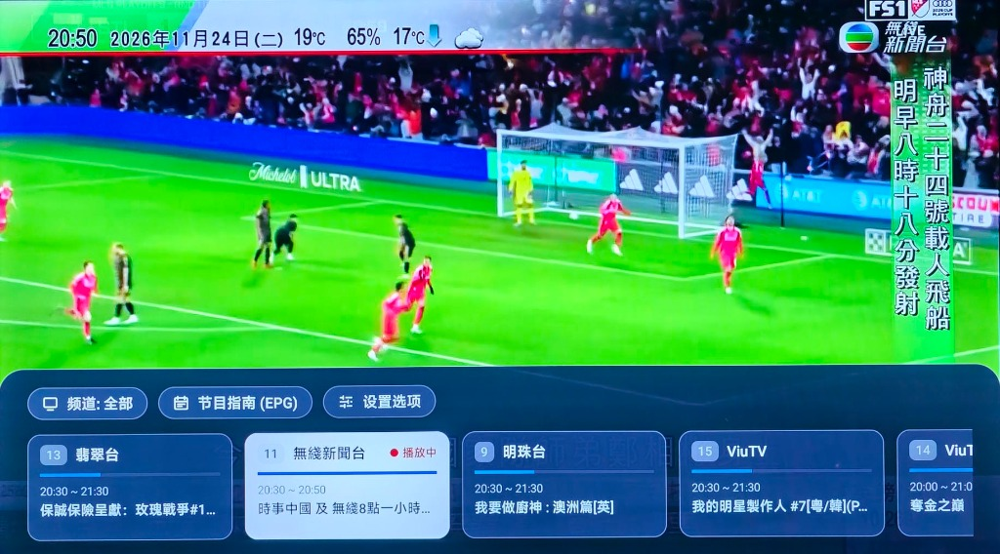
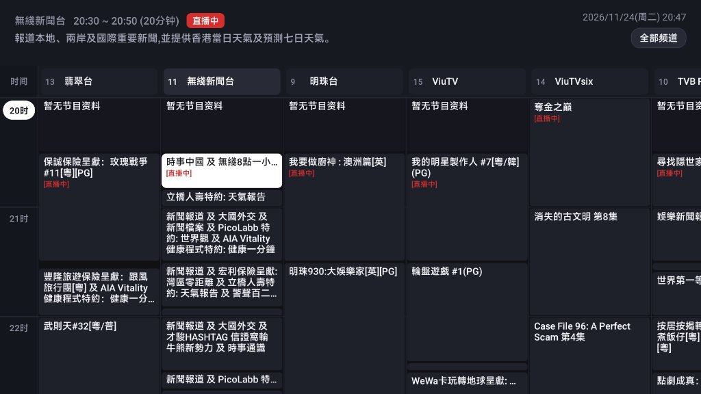
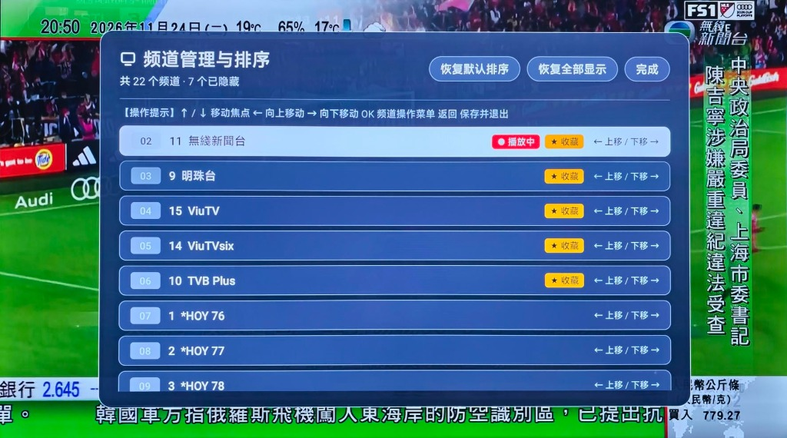
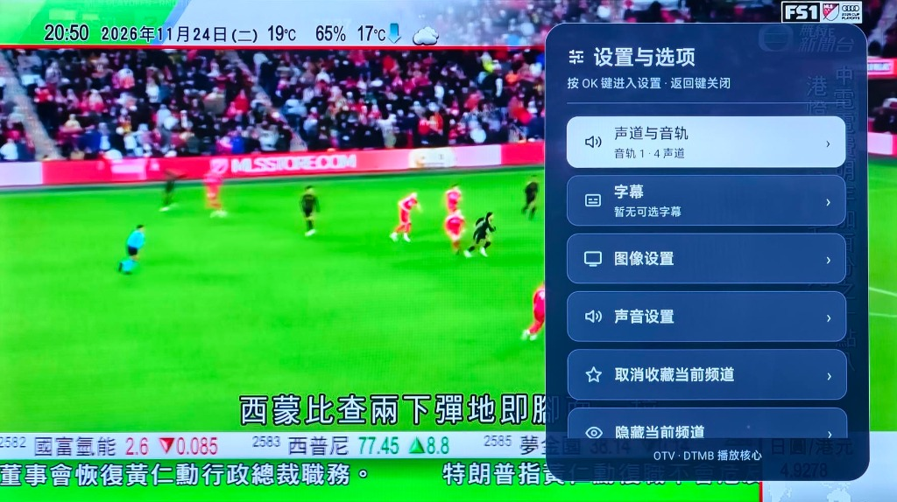

# OTV

[简体中文](README.md) | [繁體中文](README.zh-TW.md) | English

A modern terrestrial digital TV (DTMB) player built for Xiaomi Android TV.

## Why OTV?

The stock DTMB live TV app on Xiaomi TVs is overly bare-bones—it has an outdated UI, lacks a proper program guide, does not let you freely reorder or hide channels, and makes switching audio tracks or subtitles cumbersome.

Built on the native Android TV TIF framework, OTV talks directly to the TV's built-in tuner to deliver a clean, modern watching experience:

- **Immersive Channel Bar**: Horizontal cards preview currently airing programs and progress bars for effortless zapping.
- **Matrix Program Guide (EPG)**: Timeline + multi-channel grid with local caching and XMLTV import to fill in missing schedule data.
- **Channel Management & Sorting**: Reorder channels freely, favorite your go-to stations, and hide unwanted channels.
- **Audio & Subtitle Controls**: Quickly switch audio tracks and broadcast subtitles, plus a built-in **Xiaomi Audio Compatibility** toggle to fix muted channels on Xiaomi firmware.

## Screenshots

| Channel Bar | Matrix Program Guide (EPG) |
| :---: | :---: |
|  |  |
| **Channel Management & Sorting** | **Settings & Options** |
|  |  |

## Getting Started

### 1. Initial Setup
1. Open OTV and grant the **TV Listings** permission when prompted.
2. If no DTMB channels are found yet, OTV will prompt you to jump directly to the built-in Xiaomi Live TV app to scan channels, and automatically load them when you press Back.

### 2. Remote Controls

| Key | Action |
| :--- | :--- |
| **Up / Down** | Switch channels and show the top now/next info banner |
| **OK / Down** | Open the bottom channel bar (Left/Right to browse, Up for filters, EPG, and settings) |
| **Right / Guide** | Open the Matrix Program Guide (EPG) |
| **Left** | View current program summary (press Left again for full description if available) |
| **Menu** | Open the Settings & Options sidebar (audio tracks, subtitles, picture/sound, favorite & hide) |

### 3. Tips
- **Video with No Audio**: **Xiaomi Audio Compatibility** is enabled by default on Xiaomi / Redmi TVs. If you hear no audio, check the TV media volume or inspect **Settings → Audio Diagnostics**.
- **Missing EPG Data**: Broadcast signals sometimes carry limited schedule data. Press OK on an empty slot in the Program Guide (EPG) or go to **Settings → Import XMLTV Guide** to fetch Hong Kong / HOY sources or import your own `.xml` / `.xml.gz` file.

## Build & Development

Requires JDK 17+, Android SDK Platform 35, and Build-Tools 34.0.0. Ready-to-use build scripts are located under `shell/`, with versioned APKs archived into `dist/`:

### 1. Build Debug APK (application ID `com.xiaomitv.dtmb.debug`, coexists with Release)

```sh
./shell/build-debug.sh
# Add -i to install via adb and launch on TV automatically:
./shell/build-debug.sh -i
```

### 2. Build Release APK (application ID `com.xiaomitv.dtmb`)

Before building Release for the first time, run the interactive initializer once to create your keystore and local `keystore.properties` (git-ignored):

```sh
# Run once: generate keystore and local keystore.properties
./shell/init-keystore.sh

# Build & sign Release APK (add -i to install and launch on TV)
./shell/build-release.sh
./shell/build-release.sh -i
```

### 3. Connect to TV via ADB & Install

```sh
# Pass TV IP once (saved locally to git-ignored .tv-device for subsequent runs)
./shell/install-tv.sh release 192.168.31.88
./shell/install-tv.sh debug 192.168.31.88

# Subsequent runs reconnect, update, and launch automatically (-b rebuilds first, -f reinstalls on signature mismatch)
./shell/install-tv.sh release
./shell/install-tv.sh debug -b
```

For architecture details, GitHub Actions signing setup, and on-device testing, see [Developer Docs](docs/README.md) and [Release Signing Guide](docs/release-signing.md).

## License

Original OTV code is licensed under the [MIT License](LICENSE).
