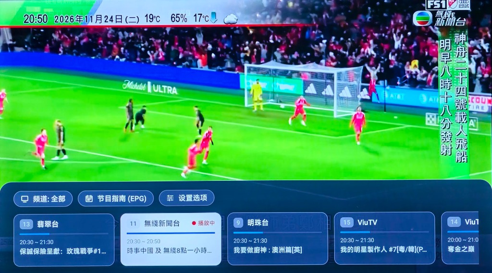
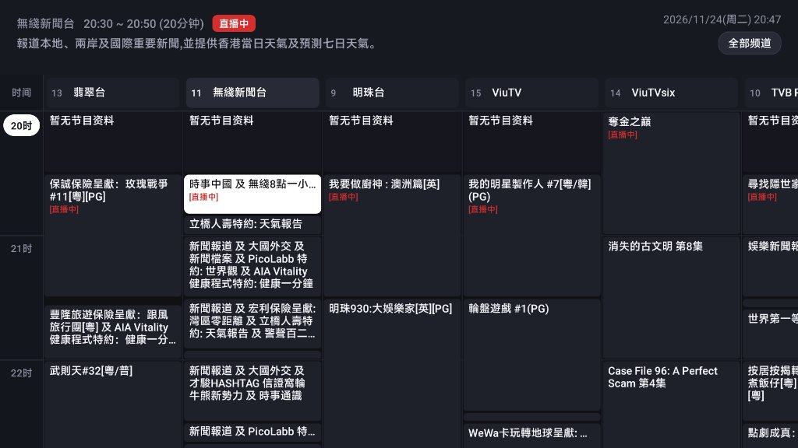
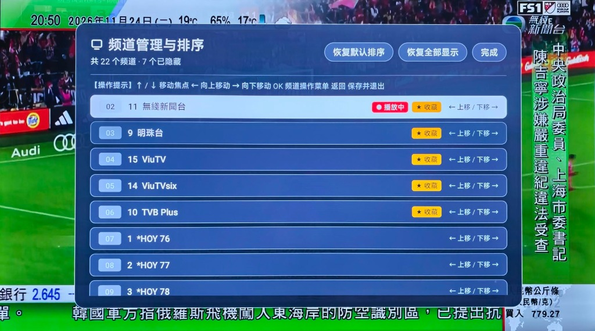
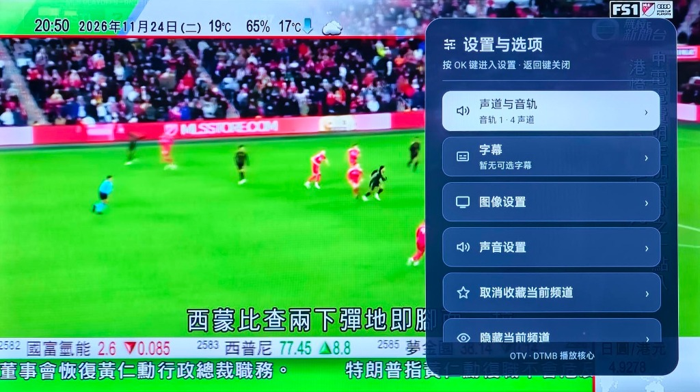

# OTV

简体中文 | [繁體中文](README.zh-TW.md) | [English](README.en.md)

专为小米 Android TV 打造的现代化地面数字电视（DTMB）播放器。

## 为什么做 OTV？

小米电视自带的 DTMB 地面数字电视应用过于简陋——界面陈旧、缺少直观的节目表、无法自由排序或隐藏频道，切换音轨和字幕也很繁琐。

OTV 基于 Android TV 原生 TIF 架构，直接调用电视内置调谐器，提供更现代、顺手的看电视体验：

- **沉浸式频道栏**：横向卡片预览各频道正在播出的节目与进度，切台更直观。
- **矩阵节目指南 (EPG)**：时间轴 + 多频道网格视图，支持本地缓存，也可导入 XMLTV 节目源补齐缺失的节目单。
- **频道管理与排序**：支持自定义频道顺序、收藏常用频道、隐藏不想看的频道。
- **便捷影音控制**：快速切换音轨/声道与广播字幕；内置「小米音频兼容」模式，解决部分频道有画无声的问题。

## 界面预览

| 底部频道栏 | 矩阵节目指南 (EPG) |
| :---: | :---: |
|  |  |
| **频道管理与排序** | **设置与选项** |
|  |  |

## 快速开始

### 1. 首次配置
1. 先在小米电视自带的直播应用中选择「地面数字电视」并完成搜台（也可在 OTV 设置中点击「前往小米直播搜台」跳转）。
2. 打开 OTV，进入 **设置选项 → 授予电视节目权限** 完成授权，应用会自动读取已搜索的频道。

### 2. 遥控器操作

| 按键 | 功能 |
| :--- | :--- |
| **上 / 下** | 切换频道，顶部显示当前及下一档节目信息条 |
| **确认 / 下** | 打开底部沉浸式频道栏（左右浏览频道，向上切换筛选、EPG 与设置） |
| **右 / Guide** | 打开矩阵节目指南 (EPG)，浏览各时段节目 |
| **左** | 查看当前节目简介（有详细简介时再按一次展开全文） |
| **Menu（菜单）** | 打开右侧设置与选项菜单（音轨、字幕、画质/声音、收藏与隐藏） |

### 3. 实用提示
- **有画面无声音**：在「设置选项 → 小米音频兼容」中开启适配即可。
- **节目表不全**：部分广播信号仅提供少量节目信息，可在「设置选项 → 导入 XMLTV 节目表」中一键下载香港/HOY 节目源，或导入自定义 `.xml` / `.xml.gz` 节目源。

## 构建与开发

需要 JDK 17、Android SDK Platform 35 与 Build-Tools 34.0.0：

```sh
./gradlew :app:assembleDebug
adb -s <电视序列号> install -r app/build/outputs/apk/debug/app-debug.apk
adb -s <电视序列号> shell am start -n com.xiaomitv.dtmb/.MainActivity
```

更多架构说明、源码导航与真机调试指南，请参阅 [开发文档](docs/README.md)。

## 开源协议

OTV 原创代码采用 [MIT 许可证](LICENSE)。
