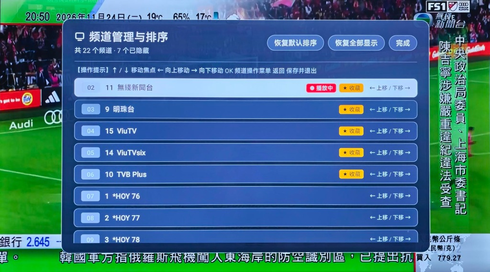

# OTV

[简体中文](README.md) | 繁體中文 | [English](README.en.md)

專為小米 Android TV 打造的現代化地面數碼電視（DTMB）播放器。

## 為什麼做 OTV？

小米電視自帶的 DTMB 地面數碼電視應用過於簡陋——介面陳舊、缺少直觀的節目表、無法自由排序或隱藏頻道，切換音軌和字幕也很繁瑣。

OTV 基於 Android TV 原生 TIF 架構，直接調用電視內置調諧器，提供更現代、順手的睇電視體驗：

- **沉浸式頻道欄**：橫向卡片預覽各頻道正在播出的節目與進度，轉台更直觀。
- **矩陣節目指南 (EPG)**：時間軸 + 多頻道網格視圖，支援本地快取，亦可匯入 XMLTV 節目源補齊缺失的節目表。
- **頻道管理與排序**：支援自訂頻道順序、收藏常用頻道、隱藏不想看的頻道。
- **便捷影音控制**：快速切換音軌／聲道與廣播字幕；內置「小米音訊相容」模式，解決部分頻道有畫無聲的問題。

## 介面預覽

| 底部頻道欄 | 矩陣節目指南 (EPG) |
| :---: | :---: |
|  |  |
| **頻道管理與排序** | **設定與選項** |
|  |  |

## 快速開始

### 1. 首次設定
1. 先在小米電視自帶的直播應用中選擇「地面數碼電視」並完成搜台（亦可在 OTV 設定中點擊「前往小米直播搜台」跳轉）。
2. 開啟 OTV，進入 **設定選項 → 授予電視節目權限** 完成授權，應用會自動讀取已搜尋的頻道。

### 2. 遙控器操作

| 按鍵 | 功能 |
| :--- | :--- |
| **上 / 下** | 切換頻道，頂部顯示目前及下一檔節目資訊條 |
| **確認 / 下** | 開啟底部沉浸式頻道欄（左右瀏覽頻道，向上切換篩選、EPG 與設定） |
| **右 / Guide** | 開啟矩陣節目指南 (EPG)，瀏覽各時段節目 |
| **左** | 查看目前節目簡介（有詳細簡介時再按一次展開全文） |
| **Menu（選單）** | 開啟右側設定與選項選單（音軌、字幕、畫質／聲音、收藏與隱藏） |

### 3. 實用提示
- **有畫面無聲音**：在「設定選項 → 小米音訊相容」中開啟適配即可。
- **節目表不全**：部分廣播訊號僅提供少量節目資訊，可在「設定選項 → 匯入 XMLTV 節目表」中一鍵下載香港／HOY 節目源，或匯入自訂 `.xml` / `.xml.gz` 節目源。

## 建置與開發

需要 JDK 17、Android SDK Platform 35 與 Build-Tools 34.0.0：

```sh
./gradlew :app:assembleDebug
adb -s <電視序號> install -r app/build/outputs/apk/debug/app-debug.apk
adb -s <電視序號> shell am start -n com.xiaomitv.dtmb/.MainActivity
```

更多架構說明、原始碼導覽與實機除錯指南，請參閱 [開發文件](docs/README.md)。

## 開源授權

OTV 原創程式碼採用 [MIT 授權條款](LICENSE)。
