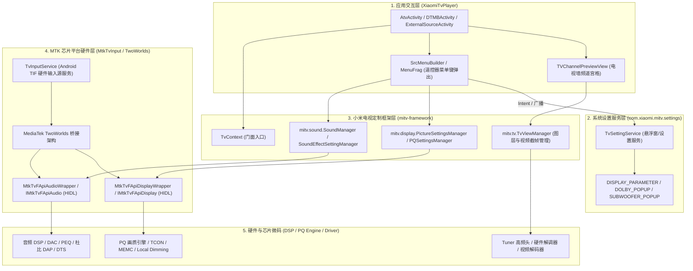
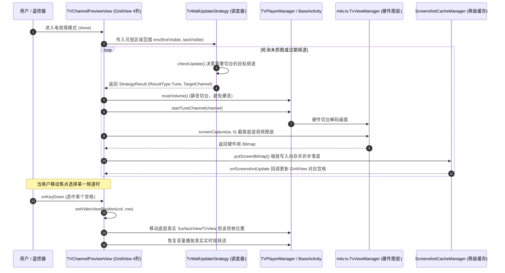

# 小米电视 APK 逆向与架构深度分析报告：电视墙与原生音视频设置

本报告基于对 `docs/` 目录下两个核心 APK 文件的完整逆向分析编写：
- **`XiaomiTvPlayer.apk`**（包名：`com.xiaomi.mitv.tvplayer`，`sharedUserId="android.uid.system"`，小米电视官方播放与信号源应用）
- **`MtkTvInput.apk`**（包名：`com.mediatek.tvinput`，`sharedUserId="android.uid.system"`，联发科 MTK 芯片平台 TIF 与底层硬件抽象服务）

完整反编译后的 Java 源码与资源文件已同步归档于 [docs/decompiled/](file:///Users/king/Developer/Projects/xiaomitv/docs/decompiled/) 目录下。

---

## 一、 系统整体架构分层

在智能电视系统中，电视播放与硬件调控属于高度特权操作（运行于 `android.uid.system` 权限下），整体呈现从**用户交互层**到**系统设置层**、**厂商框架层**、最后直达**芯片硬件抽象层（HAL/HIDL）**的清晰纵深架构：



---

## 二、 电视墙（TV Wall）实现机制逆向剖析

在 `XiaomiTvPlayer.apk` 中，电视墙被称为**电视频道预览墙（TV Channel Preview Wall）**，核心代码位于：
`com.xiaomi.mitv.tvplayer.widget.tvwall.*` 与 `com.xiaomi.mitv.tvplayer.screenshot.*`。

### 1. 核心矛盾与工程挑战
智能电视硬件（Tuner 调谐芯片与 SoC 硬件视频解码芯片）受限于硬件体积与成本，通常**仅配备 1 路主解调器与 1 条主视频硬解管线**，物理上无法做到同时实时解码播放 16~32 路高码率电视频道流。

### 2. 小米电视的架构解决方案
小米采用**“分时切台抓图轮询策略 + 焦点动态真视频嵌入”**的精妙方案，实现视觉上的多路视频监控电视墙体验：



### 3. 关键组件与核心源码分析

#### (1) 宫格呈现与焦点视窗：`TVChannelPreviewView`
- **文件路径**：[`docs/decompiled/XiaomiTvPlayer/sources/com/xiaomi/mitv/tvplayer/widget/tvwall/TVChannelPreviewView.java`](file:///Users/king/Developer/Projects/xiaomitv/docs/decompiled/XiaomiTvPlayer/sources/com/xiaomi/mitv/tvplayer/widget/tvwall/TVChannelPreviewView.java)
- 内部采用 `GridView`（4列布局，`DevUtil.getPreviewWidthPixels()` x `DevUtil.getPreviewHeightPixels()`）。
- **焦点视频无缝嵌入（`setVideoViewPosition` / `showVideo`）**：
  用户选中的宫格单元，不会展示静态图片，而是通过 `setVideoViewPosition(int col, int row)` 将系统顶层的真实播放视窗（`SurfaceView` / `TvView`）坐标和缩放比动态迁移到该宫格矩形内，实现**选中项播放真实动态视频与声音，未选中项展示最新静态截帧**。

#### (2) 智能轮询更新策略调度器：`TvWallUpdateStrategy`
- **文件路径**：[`docs/decompiled/XiaomiTvPlayer/sources/com/xiaomi/mitv/tvplayer/widget/tvwall/TvWallUpdateStrategy.java`](file:///Users/king/Developer/Projects/xiaomitv/docs/decompiled/XiaomiTvPlayer/sources/com/xiaomi/mitv/tvplayer/widget/tvwall/TvWallUpdateStrategy.java)
- **调度算法**：
  1. 调用 `env(firstVisiblePosition, lastVisiblePosition)` 锁定屏幕当前可见范围。
  2. 优先比对可见区间内各频道的快照状态（是否已有缓存、缓存时间是否过期、重试计数 `MAX_RETRY_COUNT = 1`）。
  3. 通过 `checkUpdate()` 返回 `StrategyResult`：如果需要更新则返回 `ResultType.Tune` 与频道对象，所有可见项就绪后返回 `ResultType.Finish`。

#### (3) 硬件级视频截帧：`screenCapture`
- **文件路径**：[`docs/decompiled/XiaomiTvPlayer/sources/com/xiaomi/mitv/tvplayer/BaseActivity.java`](file:///Users/king/Developer/Projects/xiaomitv/docs/decompiled/XiaomiTvPlayer/sources/com/xiaomi/mitv/tvplayer/BaseActivity.java)
- 电视视频由于硬件 Overlay 和 DRM 保护，常规 Android `View.getDrawingCache()` 截取结果全黑。小米通过系统级接口 `mTvViewManager.screenCapture(i, i2)` 直达底层显示驱动获取原始视频帧：
  ```java
  // 核心实现逻辑 (BaseActivity.java)
  bitmap = this.mTvViewManager.screenCapture(i, i2);
  if (channel.scrambled || channel.not_support_4k) {
      screenCapture = DevUtil.createBlackBitmap((BaseActivity) this.mPlayerUI);
  } else {
      screenCapture = ((BaseActivity) this.mPlayerUI).screenCapture(
          DevUtil.getScreenWidthPixels(), DevUtil.getScreenHeightPixels());
  }
  ```

#### (4) 内存与磁盘两级缓存：`ScreenshotCacheManager` 与 `ChannelPreviewMap`
- **文件路径**：[`docs/decompiled/XiaomiTvPlayer/sources/com/xiaomi/mitv/tvplayer/screenshot/`](file:///Users/king/Developer/Projects/xiaomitv/docs/decompiled/XiaomiTvPlayer/sources/com/xiaomi/mitv/tvplayer/screenshot/)
- 截取的大图经 `Bitmap.createScaledBitmap` 降采样为缩略图后，先存入 `ChannelPreviewMap` 内存表供 UI 即时刷新。
- 后台工作线程由 `ScreenshotCacheManager` 负责将位图按频道编号编码压缩存储于文件系统私有目录，在下次进入电视墙时能瞬间展示历史缩略图，避免冷启动白块。

---

## 三、 电视原生音视频设置（Audio/Video Settings）逆向剖析

智能电视的音频与视频设置具有强硬件绑定的特征。通过分析 `XiaomiTvPlayer` 与 `MtkTvInput`，我们还原了**上层快捷调节、系统服务中台、芯片原厂驱动**的完整闭环。

### 1. 交互层与中台服务调度（XiaomiTvPlayer）

在 `BaseActivity.java` 中，按键监听拦截遥控器菜单键（`KEYCODE_MENU = 82`）：
```java
if (i == 82) {
    showMenuFrag(); // 弹出基于 MenuBuilder 构建的系统级控制面板
    return true;
}
```

菜单构建器 `BaseActivity.SrcMenuBuilder` 提供了清晰的分类流转：

#### (1) 图像/视频设置通道
- **快速画质场景切换**：
  - 点击“图像模式”（标准/电影/艳丽/运动/游戏/监视器等）执行 `setSceneMode`：
    ```java
    PictureSettingsManager.getInstance().setSceneMode(modeId);
    if (modeId == 1) {
        doSendBroadCast("com.xiaomi.mitv.settings.DISPLAY_SETTINGS_POPUP");
    }
    ```
- **画面比例调节**：
  - 调用 `this.mTvViewManager.setPicAspectRatio(ratio)`，支持：
    - `SCREEN_AUTO_SCALE` (自动)
    - `SCREEN_KEEP_RATIO` (保持比例 16:9 / 4:3)
    - `SCREEN_SCRETCH` (拉伸全屏)
    - `SCREEN_ENLARGEMENT` (点对点放大/过扫描)
- **高级画质调节面板（悬浮窗服务）**：
  - 点击“图像参数”调用 `tuneSettingMenuGraph()`：
    ```java
    Intent intent = new Intent("com.xiaomi.mitv.settings.DISPLAY_PARAMETER");
    intent.putExtra("from", "tvPlayer");
    intent.setComponent(new ComponentName("com.xiaomi.mitv.settings", "com.xiaomi.mitv.settings.TvSettingService"));
    getApplication().startService(intent);
    ```
  - 点击“高级设置”：发送广播 `com.xiaomi.mitv.settings.display.advanced`；
  - 点击“专家模式”：发送广播 `com.xiaomi.mitv.settings.display.expert`。

#### (2) 音频/声音设置通道
- **预设音效模式切换**：
  - 点击“声音模式”（标准/电影/音乐/新闻/游戏/自定义）执行 `changeSoundMode`：
    ```java
    SoundModeHelper.getInstance().setSoundMode(modeId);
    if (modeId == 3) {
        doSendBroadCast("com.xiaomi.mitv.settings.DOLBY_POPUP");
    }
    ```
- **详细声学参数调优**：
  - 点击“声音设置”调用 `tuneSettingSoundMode()`：
    ```java
    Intent intent = new Intent(DevConfigureUtil.isDolbySupported() ? 
        "com.xiaomi.mitv.settings.DOLBY_POPUP" : "com.xiaomi.mitv.settings.SOUND_EFFECT_POPUP");
    intent.putExtra("from", "tvPlayer");
    intent.setComponent(new ComponentName("com.xiaomi.mitv.settings", "com.xiaomi.mitv.settings.TvSettingService"));
    getApplication().startService(intent);
    ```
- **外置伴音与低音炮**：
  - 检测到外接低音炮时，发送广播 `com.xiaomi.mitv.settings.SUBWOOFER_POPUP`。

---

### 2. 芯片平台底层实现（MediaTek TwoWorlds & HIDL HAL）

在底层，所有画质（PQ）和音质（AQ）设置都会通过 Binder/HIDL 跨进程直达 `vendor.mediatek.tv.mtktvfactory@1.0` 服务，由芯片 DSP 和 PQ 引擎执行硬件寄存器配置：

#### (1) 图像/画质硬件层控制（`IMtkTvFApiDisplay`）
对应源码：[`docs/decompiled/MtkTvInput/sources/vendor/mediatek/tv/mtktvfactory/V1_0/IMtkTvFApiDisplay.java`](file:///Users/king/Developer/Projects/xiaomitv/docs/decompiled/MtkTvInput/sources/vendor/mediatek/tv/mtktvfactory/V1_0/IMtkTvFApiDisplay.java)

| 核心硬件方法 | 功能说明 | 硬件驱动目标 |
| :--- | :--- | :--- |
| `a_hidl_a_mtktvfapi_disp_set_picture_param` | 基础图像参数下发 | 控制亮度 (Brightness)、对比度 (Contrast)、饱和度、锐度、色调 |
| `a_hidl_a_mtktvfapi_disp_set_color_temperature` | 白平衡/色温微调 | 下发 R/G/B Gain 与 R/G/B Offset 到色彩矩阵 |
| `a_hidl_a_mtktvfapi_disp_set_gamma_curve` | 伽马曲线校正 | 注入自定义 Gamma 曲线阵列（R、G、B 独立控制） |
| `a_hidl_a_mtktvfapi_disp_set_ldm_pattern` | 棋盘背光/分区控光 | 控制 Mini-LED / Local Dimming 背光芯片分区衰减与增强 |
| `a_hidl_a_mtktvfapi_disp_get_memc_version` | 运动补偿与插帧 | 配置 FRC/MEMC 芯片进行运动矢量估计与运动补偿（消除拖影） |
| `a_hidl_a_mtktvfapi_disp_get_vrr_framerate` | 可变刷新率与高刷 | 控制 TCON 芯片在高刷新率模式（120Hz/144Hz/240Hz）切换与防撕裂 |
| `a_hidl_a_mtktvfapi_disp_oled_set_attr / set_jb` | OLED 屏幕防烧屏 | 执行像素位移（Pixel Shift）、残影消除与 Off-RS 补偿 |

#### (2) 音频/声学硬件层控制（`IMtkTvFApiAudio`）
对应源码：[`docs/decompiled/MtkTvInput/sources/vendor/mediatek/tv/mtktvfactory/V1_0/IMtkTvFApiAudio.java`](file:///Users/king/Developer/Projects/xiaomitv/docs/decompiled/MtkTvInput/sources/vendor/mediatek/tv/mtktvfactory/V1_0/IMtkTvFApiAudio.java)

| 核心硬件方法 | 功能说明 | 硬件驱动目标 |
| :--- | :--- | :--- |
| `a_hidl_mtktvfapi_aud_basic_snd_set_param` | 基础声音均衡 | 调节高音 (Treble)、低音 (Bass)、左右声道平衡 (Balance) |
| `a_hidl_mtktvfapi_aud_adv_set_peq_value` | 参量均衡器 (PEQ) | 设置各频段中心频率 (Frequency)、增益 (Gain) 与品质因数 (Q值) |
| `a_hidl_mtktvfapi_aud_adv_snd_set_dolby_dap_param` | 杜比音频处理 (DAP) | 注入杜比多声道环绕声增强、对白增强 (DE) 与音量平衡参数 |
| `a_hidl_mtktvfapi_aud_set_dts_loundness_enable` | DTS 声效增强 | 开启 DTS Virtual:X 虚拟环绕与清晰度增强 |
| `a_hidl_mtktvfapi_aud_set_attr_AI_AQ` | 智能音质识别 (AI-AQ) | 依据当前输入音频内容特征，动态在新闻/音乐/影院模式间平滑自适应 |
| `a_hidl_mtktvfapi_aud_adv_set_speaker_delay` | 音画同步延迟控制 | 精确调节毫秒级音频输出延迟（针对光纤 S/PDIF 和 HDMI eARC 输出） |
| `a_hidl_mtktvfapi_aud_set_volume_table` | 硬件音量曲线映射 | 注入声压级分贝对数曲线，确保 0~100 级音量调节平滑均匀 |

---

## 四、 总结与自研建议

通过对上述两个 APK 的逆向工程，可以提炼出如下核心实现结论与设计指导原则：

1. **电视墙（多路监控/多台选台）设计模式**：
   - **不要**尝试在单解码器电视芯片上同时开启几十个解码实例，这会导致 OOM 或硬解资源耗尽崩溃。
   - **应当**采用**“分时切台静音轮询 + 截帧降采样缓存 + 焦点动态窗口覆盖”**。普通状态展示静态缩略图，用户焦点移动到哪一个单元格，就将底层的真实视频解码器输出窗口无缝锚定到该单元格上播放动态流。
2. **硬件级视频画面抓取（Screen Capture）**：
   - 电视视频由于属于硬件独立图层（Hardware Overlay），普通 Android 应用级别的截图 API 会失效。必须依赖系统级签名与 UID（`android.uid.system`），调用底层 Display/TvView 的硬件截帧驱动接口。
3. **音视频原厂设置的解耦设计**：
   - 播放器 UI 不应硬编码硬件寄存器逻辑，而是分为两层：
     - **业务层/播放器**：通过统一的 Framework Facade 接口（如 `TvContext`、`PictureSettingsManager`、`SoundManager`）进行快速设置与状态同步。
     - **深度设置层**：通过显式 Intent / Broadcast 调起独立的系统级浮层服务（`TvSettingService`），使画质与音质调整能够在全屏播放视频的同时作为浮层半透明展示，实时预览调节效果。
   - 底层平台通过 HIDL/AIDL 服务（如 `IMtkTvFApiDisplay` 与 `IMtkTvFApiAudio`）屏蔽不同芯片平台（联发科 MTK、晶晨 Amlogic、晨星 MStar）的物理差异。
