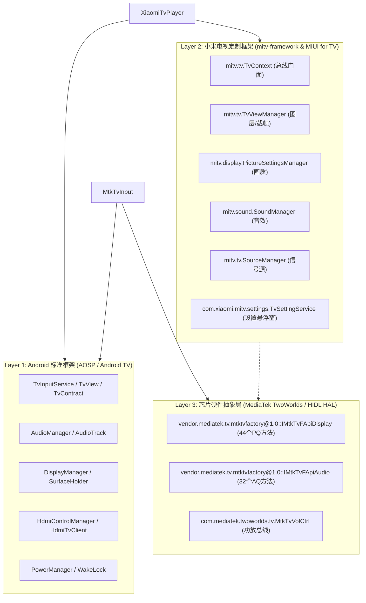

# 小米电视与联发科核心 APK 系统接口调用全景指南

本参考文档基于对 `XiaomiTvPlayer.apk`（小米电视播放与信号源应用）和 `MtkTvInput.apk`（联发科电视输入服务与硬件抽象层）的完整逆向分析，详细梳理两款应用所依赖与调用的**标准系统接口、厂商定制框架接口、系统 IPC 服务以及芯片底层 HAL/HIDL 接口**。

---

## 一、 系统接口分类体系架构

智能电视由于涉及音视频硬件解码、图层 Overlay 混合、信号源切换与芯片级画质/音效寄存器调校，其系统接口呈现出三层纵深架构：



---

## 二、 `XiaomiTvPlayer.apk` 调用的系统接口清单

运行权限：`android.uid.system`（系统签名特权级应用）

### 1. Android 标准系统服务接口

| 系统服务 / 接口类 | 调用方法 / 核心职责 | 应用内调用场景 |
| :--- | :--- | :--- |
| **`android.media.tv.TvView`** | `tune(inputId, channelUri)`<br>`reset()`<br>`setStreamVolume(volume)` | 电视播放、切台（Tune）、音量控制 |
| **`android.media.tv.TvContract`** | `Channels.CONTENT_URI`<br>`Programs.CONTENT_URI` | 读写查询数字电视（DTMB）与模拟电视（ATV）频道与 EPG 节目表 |
| **`android.media.AudioManager`** | `adjustStreamVolume(stream, dir, flags)`<br>`getStreamVolume(stream)`<br>`setStreamMute(stream, state)` | 伴音静音（切台/电视墙轮询抓图时静音防爆音）与主音量调节 |
| **`android.view.SurfaceView`** / **`SurfaceHolder`** | `getHolder().addCallback(...)`<br>`setZOrderMediaOverlay(true)` | 硬件解码图层创建、生命周期监听与画面层叠关系管理 |
| **`android.hardware.display.DisplayManager`** | `getDisplays()`<br>`getDisplay(Display.DEFAULT_DISPLAY)` | 检测屏幕分辨率、多屏环境与刷新率参数 |
| **`android.hardware.hdmi.HdmiControlManager`** | `getTvClient()`<br>`oneTouchPlay(...)` | HDMI-CEC 单键播放、外部信号源联动待机/唤醒 |
| **`android.os.PowerManager`** | `newWakeLock(PARTIAL_WAKE_LOCK, tag)`<br>`wakeLock.acquire() / release()` | 搜台、后台切台录像、电视墙轮询抓图时防止系统休眠 |
| **`android.os.SystemProperties`** | `get("sys.cast.state")`<br>`get("vendor.mitvsource.current")`<br>`get("sys.one_touch_play")` | 读取系统投屏状态、当前主芯片信号源通路、CEC 连动状态 |

---

### 2. 小米电视定制框架服务接口（`mitv.*`）

小米电视将核心硬件能力抽象为 `mitv.tv.TvContext` 统一服务总线：

#### (1) 硬件图层与截帧管理：`mitv.tv.TvViewManager`
- **代码文件**：[`docs/decompiled/XiaomiTvPlayer/sources/mitv/tv/TvViewManager.java`](file:///Users/king/Developer/Projects/xiaomitv/docs/decompiled/XiaomiTvPlayer/sources/mitv/tv/TvViewManager.java)

| 接口方法签名 | 功能说明 | 核心应用场景 |
| :--- | :--- | :--- |
| `Bitmap screenCapture(int width, int height)` | **硬件图层截帧**（穿透硬件 Overlay 获取底层视频帧） | **电视墙频道预览图抓取**、多任务缩略图生成 |
| `boolean setPicAspectRatio(int ratio)` | 画面显示比例调节 | 16:9、4:3、全屏拉伸（`SCREEN_SCRETCH`）、自动缩放、点对点等 |
| `int getPicAspectRatio()` | 获取当前画面宽高比 | 菜单选项状态回显 |
| `VideoInfo getVideoInfo()` | 获取当前输入源信号物理参数 | 获取水平/垂直分辨率、场频帧率、色彩格式、逐行/隔行扫描 |
| `boolean isDolbyVision()` | 检测是否为杜比视界信号 | 触发杜比视界角标点亮与画质链路锁定 |
| `void registerViewContentListener(...)` | 注册画面内容类型监听器 | 监听片源动态从 SDR 切换为 HDR/Dolby Vision 并重载画质参数 |
| `boolean setCommonCommand(cmd, args)` | 底层 Surface 变形扩展指令 | 支持 `surface-shape-crop`、`surface-shape-scale`、`surface-shape-move` |

#### (2) 画质与显示设置：`mitv.display.PictureSettingsManager` 与 `PQSettingsManager`
- **代码文件**：[`docs/decompiled/XiaomiTvPlayer/sources/mitv/display/PictureSettingsManager.java`](file:///Users/king/Developer/Projects/xiaomitv/docs/decompiled/XiaomiTvPlayer/sources/mitv/display/PictureSettingsManager.java)

| 接口方法签名 | 功能说明 | 控制的硬件参数 |
| :--- | :--- | :--- |
| `setSceneMode(int mode)` / `getSceneMode()` | 图像预设场景模式 | 标准、亮丽、电影、运动、游戏、监视器等 |
| `setBacklightValue(int val)` / `getBacklight()` | 背光亮度控制 | 面板背光电流 / PWM 占空比 |
| `setBrightness / setContrast / setSaturation / setSharpness / setHue` | 基础五大画质调节 | 亮度、对比度、色彩饱和度、清晰度/锐度、色调 |
| `setColorTemperature(int temp)` | 色温调节 | 标准、冷色、暖色、自定义 |
| `setWhiteBalanceValue(int color, int val)` | 白平衡微调 | R/G/B Gain（增益）与 R/G/B Offset（偏置） |
| `setNoiseReductionMode(int mode)` / `setDnr(int val)` | 数字降噪等级 | 3D/2D 降噪强度、MPEG 块状噪点抑制 |
| `enableMemc(boolean enable)` / `setMemcValue(int val)` | MEMC 运动补偿 | 防抖动平滑度、防拖影清晰度（插帧控制） |
| `setLocalDimming(boolean enable)` | 棋盘背光分区控光 | Mini-LED / Local Dimming 动态背光开关 |
| `setFreeSync(int mode)` / `setHighFrameVrr(bool)` | 动态帧率防撕裂 | AMD FreeSync 与 VRR 可变刷新率模式开关 |
| `setGamma(int gamma)` / `setGammaMode(mode)` | 伽马校正 | Gamma 1.8 / 2.0 / 2.2 / 2.4 曲线切换 |
| `oledSetAttr(int attr, int val)` / `setOffRsState(int val)` | OLED 屏幕防烧屏 | 像素位移（Pixel Shift）、残影消除刷新 |

#### (3) 声学与音频设置：`mitv.sound.SoundManager` 与 `SoundEffectSettingManager`
- **代码文件**：[`docs/decompiled/XiaomiTvPlayer/sources/mitv/sound/SoundManager.java`](file:///Users/king/Developer/Projects/xiaomitv/docs/decompiled/XiaomiTvPlayer/sources/mitv/sound/SoundManager.java)

| 接口方法签名 | 功能说明 | 控制的音频硬件链路 |
| :--- | :--- | :--- |
| `setSoundMode(int mode)` / `getSoundModeStatus()` | 声音模式切换 | 标准、影院、音乐、新闻、游戏预设声学配置 |
| `setOutputDevice(int device)` | 音频物理输出通道选择 | 电视内置扬声器、S/PDIF 光纤/同轴、HDMI ARC/eARC、Line Out |
| `setSpdifOutMode(int mode)` | 数字音频输出编码格式 | PCM 解码输出、Raw 源码直接透传（Passthrough）、Auto |
| `setEarcState(int state)` | HDMI eARC 控制 | 开启 32 通道 192kHz 无损全景声音频回传 |
| `setEqualizerSettings(Equalizer.Settings)` | 用户多频段均衡器 | 100Hz、300Hz、1kHz、3kHz、10kHz 各频段增益 |
| `setHardwareEQParam(...)` / `setHardwareDRCParam(...)` | 硬件级 EQ 与 DRC | 注入硬件音频 DSP 的滤波系数与动态范围压缩参数 |
| `setDolbyStatus` / `setDolbyVirtualSurround` | 杜比音效与虚拟环绕 | 杜比多声道声场扩展、环绕声增强 |
| `setDolbyVolumeLeveler` / `setDolbyDEAmount` | 杜比音量平衡与对白增强 | 防止切台台标音量突变，提升人声清晰度 |
| `setDtsCertifactionMode` / `setDtsDrcEnable` | DTS 音效控制 | DTS Virtual:X 虚拟多声道与响度增强 |
| `setSpeakerDelay(int delayMs)` | 音画同步延迟控制 | 数字输出（S/PDIF 或 eARC）时的毫秒级声音延时校正 |
| `setMiSoundSurroundEnable` / `setHarmanSoundEnable` | 品牌声效算法 | 小米自研 MiSound 环绕引擎与哈曼卡顿调音使能 |

#### (4) 信号源管理：`mitv.tv.SourceManager`
- 控制与监听：`SOURCE_HDMI1`、`SOURCE_HDMI2`、`SOURCE_HDMI3`、`SOURCE_AV`、`SOURCE_ATV`、`SOURCE_DTV`、`SOURCE_VGA`。
- 监听外部 HDMI 线缆插拔（Plug In / Plug Out）事件与即时连动播放。

#### (5) 低音炮伴音外设：`mitv.subwoofer.SubwooferManager`
- 侦测外接无线/有线 Subwoofer 伴音连接状态、调节低音增益与分频截止频率。

---

### 3. 小米系统级 IPC 服务调用与广播协议

当用户在播放器界面按下遥控器菜单键（Keycode 82）时，除了轻量直接调控外，深度调节均通过显式 Intent 或 Broadcast 与系统服务进行解耦通信：

| 目标系统组件 | Action / 协议名称 | 通信类型 | 触发业务场景 |
| :--- | :--- | :--- | :--- |
| **`com.xiaomi.mitv.settings.TvSettingService`** | `com.xiaomi.mitv.settings.DISPLAY_PARAMETER` | `startService(Intent)` | 调起全屏视频上方的**半透明画质参数浮层面板**（背光、对比、锐度、饱和度、色温滑块） |
| **`com.xiaomi.mitv.settings.TvSettingService`** | `com.xiaomi.mitv.settings.DOLBY_POPUP` | `startService(Intent)` | 调起杜比音效（Dolby Audio/Atmos）专用调校悬浮窗 |
| **`com.xiaomi.mitv.settings.TvSettingService`** | `com.xiaomi.mitv.settings.SOUND_EFFECT_POPUP` | `startService(Intent)` | 调起基础声音效果调节悬浮窗 |
| **`com.xiaomi.mitv.settings`** | `com.xiaomi.mitv.settings.SUBWOOFER_POPUP` | `sendBroadcast(Intent)` | 调起低音炮连接配对与声学增益浮层 |
| **`com.xiaomi.mitv.settings`** | `com.xiaomi.mitv.settings.display.advanced` | `sendBroadcast(Intent)` | 调起专业高级图像画质设置列表 |
| **`com.xiaomi.mitv.settings`** | `com.xiaomi.mitv.settings.display.expert` | `sendBroadcast(Intent)` | 调起专家画质模式（精确色彩管理 CMS、Gamma 曲线校准） |

---

## 三、 `MtkTvInput.apk` 调用的系统接口清单

运行权限：`android.uid.system`（联发科 MTK 平台 TIF 与硬件抽象服务）

### 1. Android TV Input Framework (TIF) 核心服务接口

`MtkTvInput` 继承并重写了标准的 `android.media.tv.TvInputService`：
- **核心基类**：[`com.mediatek.tvinputservice.AbstractTvInputServiceBase`](file:///Users/king/Developer/Projects/xiaomitv/docs/decompiled/MtkTvInput/sources/com/mediatek/tvinputservice/AbstractTvInputServiceBase.java)

| 接口方法 | 调用角色 | 核心交互逻辑 |
| :--- | :--- | :--- |
| `onCreateSession(String inputId)` | Framework -> Service | 为指定的硬件输入源（如 HDMI 1 或 Tuner）创建会话实例 |
| `onSetSurface(Surface surface)` | Framework -> Service | 将 Android Framework 层传入的渲染 Surface 绑定到 MTK 底层硬件视频解码管道 |
| `onTune(Uri channelUri)` | Framework -> Service | 接收切台指令，通知底层的 Tuner 硬件解调器切换高频载波频率与频点 |
| `onSetStreamVolume(float volume)` | Framework -> Service | 同步当前硬件输入流的伴音音量 |
| `onAppPrivateCommand(String action, Bundle data)` | Framework -> Service | **私有扩展透传接口**：接收上层传递的特殊芯片调优指令 |
| `notifyVideoAvailable()` | Service -> Framework | 硬件视频流第一帧成功出图，通知系统取消黑屏占位图 |
| `notifyVideoUnavailable(int reason)` | Service -> Framework | 信号弱、无信号或未授权时上报原因（`REASON_BUFFERING`、`REASON_UNKNOWN`） |
| `notifyTracksChanged(List<TvTrackInfo> tracks)` | Service -> Framework | 向 TIF 上报解析到的视频分辨率、音频编码（AC3/E-AC3/AAC）与多语言音轨 |

---

### 2. 联发科硬件抽象层（HIDL HAL）接口

MTK 采用 TwoWorlds 架构将底层硬件接口导出为标准的 HIDL 服务（运行于 `vendor.mediatek.tv.mtktvfactory@1.0`）：

#### (1) 显示与画质底层 HAL：`IMtkTvFApiDisplay`
- **代码文件**：[`docs/decompiled/MtkTvInput/sources/vendor/mediatek/tv/mtktvfactory/V1_0/IMtkTvFApiDisplay.java`](file:///Users/king/Developer/Projects/xiaomitv/docs/decompiled/MtkTvInput/sources/vendor/mediatek/tv/mtktvfactory/V1_0/IMtkTvFApiDisplay.java)

```java
// 核心 HIDL 远程方法（通过 hwBinder 跨进程调用 /vendor/bin/hw/vendor.mediatek.tv.mtktvfactory@1.0-service）
public interface IMtkTvFApiDisplay extends IBase {
    // 图像基础参数下发 (亮度/对比度/锐度/饱和度/色调)
    int a_hidl_a_mtktvfapi_disp_set_picture_param(int paramType, int val) throws RemoteException;
    
    // 白平衡 RGB 增益与偏移
    int a_hidl_a_mtktvfapi_disp_set_color_temperature(int rGain, int gGain, int bGain, int rOffset, int gOffset, int bOffset) throws RemoteException;
    
    // 注入 Gamma 曲线数组
    int a_hidl_a_mtktvfapi_disp_set_gamma_curve(ArrayList<Short> rCurve, ArrayList<Short> gCurve, ArrayList<Short> bCurve) throws RemoteException;
    
    // 局域控光模式 (Mini-LED / Local Dimming)
    int a_hidl_a_mtktvfapi_disp_set_ldm_pattern(int pattern) throws RemoteException;
    
    // MEMC 运动补偿模块控制
    void a_hidl_a_mtktvfapi_disp_get_memc_version(a_hidl_a_mtktvfapi_disp_get_memc_versionCallback cb) throws RemoteException;
    
    // VRR 动态高刷与高帧率模式控制
    void a_hidl_a_mtktvfapi_disp_get_vrr_framerate(a_hidl_a_mtktvfapi_disp_get_vrr_framerateCallback cb) throws RemoteException;
    boolean a_hidl_a_mtktvfapi_disp_get_vrr_high_frame_rate_mode() throws RemoteException;
    
    // 液晶 OverDrive 驱动模式
    int a_hidl_a_mtktvfapi_disp_set_od_mode(byte mode) throws RemoteException;
    
    // OLED 烧屏抑制与残影刷新
    int a_hidl_a_mtktvfapi_disp_oled_set_attr(int attr, int val) throws RemoteException;
    int a_hidl_a_mtktvfapi_disp_oled_set_jb() throws RemoteException;
    int a_hidl_a_mtktvfapi_disp_oled_set_offrs() throws RemoteException;
    
    // 截屏到底层 USB 设备存储
    int a_hidl_a_mtktvfapi_disp_capture_screen_to_usb(String path, int format) throws RemoteException;
}
```

#### (2) 音频与 DSP 底层 HAL：`IMtkTvFApiAudio`
- **代码文件**：[`docs/decompiled/MtkTvInput/sources/vendor/mediatek/tv/mtktvfactory/V1_0/IMtkTvFApiAudio.java`](file:///Users/king/Developer/Projects/xiaomitv/docs/decompiled/MtkTvInput/sources/vendor/mediatek/tv/mtktvfactory/V1_0/IMtkTvFApiAudio.java)

```java
// 核心 HIDL 音频控制接口
public interface IMtkTvFApiAudio extends IBase {
    // 基础声效 (低音 Bass, 高音 Treble, 平衡 Balance)
    int a_hidl_mtktvfapi_aud_basic_snd_set_param(int type, MtkTvFApiAudBasicSoundParam_t param) throws RemoteException;
    
    // 参量均衡器 (PEQ) 多段频率、增益与 Q 值配置
    int a_hidl_mtktvfapi_aud_adv_set_peq_value(short band, short freq, short gain, short q) throws RemoteException;
    
    // 杜比 DAP 音效参数结构体注入
    int a_hidl_mtktvfapi_aud_adv_snd_set_dolby_dap_param(MtkTvFApiAdvSndDolbyDapParams_t params) throws RemoteException;
    
    // DTS 虚拟环绕声与响度提升使能
    int a_hidl_mtktvfapi_aud_set_dts_loundness_enable(boolean enable) throws RemoteException;
    
    // AI-AQ 智能声学自适应模式
    int a_hidl_mtktvfapi_aud_set_attr_AI_AQ(boolean enable) throws RemoteException;
    
    // 音画同步延迟 (扬声器/数字输出 Delay 毫秒数)
    int a_hidl_mtktvfapi_aud_adv_set_speaker_delay(int delayMs) throws RemoteException;
    
    // 音频降噪 (NR) 与前级缩放
    int a_hidl_mtktvfapi_aud_adv_set_NR(boolean enable, short level) throws RemoteException;
    int a_hidl_mtktvfapi_aud_adv_set_prescale(boolean enable, short scale) throws RemoteException;
    
    // 硬件音量分贝表映射配置
    int a_hidl_mtktvfapi_aud_set_volume_table(int streamType, ArrayList<Short> table, String curveName) throws RemoteException;
}
```

#### (3) 主板音频硬件总线控制：`com.mediatek.twoworlds.tv.MtkTvVolCtrl`
- 负责与主板音频功放芯片（Audio Amp I2C 控制）、耳机口检测、静音电路（Mute GPIO）直接对接。

---

## 四、 核心系统接口对照与协同矩阵

| 业务场景 | `XiaomiTvPlayer`（应用与框架层调用） | `MtkTvInput`（TIF 与芯片硬件层执行） | 底层硬件对象 |
| :--- | :--- | :--- | :--- |
| **电视墙选台抓图** | `mTvViewManager.screenCapture(w, h)` | `a_hidl_a_mtktvfapi_disp_capture_screen_to_usb` | 硬件 Overlay 帧缓存 / VDP (Video Display Processor) |
| **电视频道切台** | `TvView.tune(channelUri)` | `TvInputService.Session.onTune()` | Tuner 高频头 / 硬件解调器 (Demodulator) |
| **画面比例切换** | `mTvViewManager.setPicAspectRatio(ratio)` | `TvViewManager.COMMAND_ATV_SHAPE_SCALE` | 硬件图像缩放引擎 (Scaler Engine) |
| **画质模式调节** | `PictureSettingsManager.setSceneMode()` | `IMtkTvFApiDisplay.set_picture_param` | PQ 色彩校准引擎 / Look-Up Table (LUT) |
| **白平衡/色温调节** | `PictureSettingsManager.setColorTemperature()` | `IMtkTvFApiDisplay.set_color_temperature` | R/G/B 数字增益与偏置寄存器 |
| **运动防抖 (MEMC)** | `PictureSettingsManager.enableMemc()` | `IMtkTvFApiDisplay.get_memc_version` | FRC / 运动估计插帧独立芯片 |
| **声音模式切换** | `SoundManager.setSoundMode()` | `IMtkTvFApiAudio.basic_snd_set_param` | 音频 DSP 混音与后处理芯片 |
| **杜比全景声音效** | `SoundManager.setDolbyStatus()` | `IMtkTvFApiAudio.set_dolby_dap_param` | 杜比专用硬件认证解码器 / DAP 引擎 |
| **音画同步校准** | `SoundManager.setSpeakerDelay()` | `IMtkTvFApiAudio.set_speaker_delay` | S/PDIF / HDMI eARC 环形延时缓冲区 (Delay FIFO) |

---

## 五、 系统签名与特权权限声明

两款应用均配置了 `android:sharedUserId="android.uid.system"`，其声明的关键特权权限如下：

```xml
<!-- 视频输入与硬件图层控制权限 -->
<uses-permission android:name="android.permission.TV_INPUT_HARDWARE" />
<uses-permission android:name="android.permission.RECEIVE_INPUT_EVENT" />
<uses-permission android:name="com.google.android.tv.permission.RECEIVE_INPUT_EVENT" />

<!-- HDMI 与 CEC 连动控制权限 -->
<uses-permission android:name="android.permission.HDMI_CEC" />
<uses-permission android:name="android.permission.CHANGE_HDMI_CEC_ACTIVE_SOURCE" />

<!-- 系统电源与屏幕唤醒锁 -->
<uses-permission android:name="android.permission.DEVICE_POWER" />
<uses-permission android:name="android.permission.WAKE_LOCK" />

<!-- EPG 节目数据全量读写权限 -->
<uses-permission android:name="com.android.providers.tv.permission.READ_EPG_DATA" />
<uses-permission android:name="com.android.providers.tv.permission.WRITE_EPG_DATA" />
<uses-permission android:name="com.android.providers.tv.permission.ACCESS_ALL_EPG_DATA" />

<!-- 系统设置项与全局状态修改权限 -->
<uses-permission android:name="android.permission.WRITE_SETTINGS" />
<uses-permission android:name="android.permission.INTERACT_ACROSS_USERS_FULL" />
<uses-permission android:name="android.permission.STOP_APP_SWITCHES" />
```
